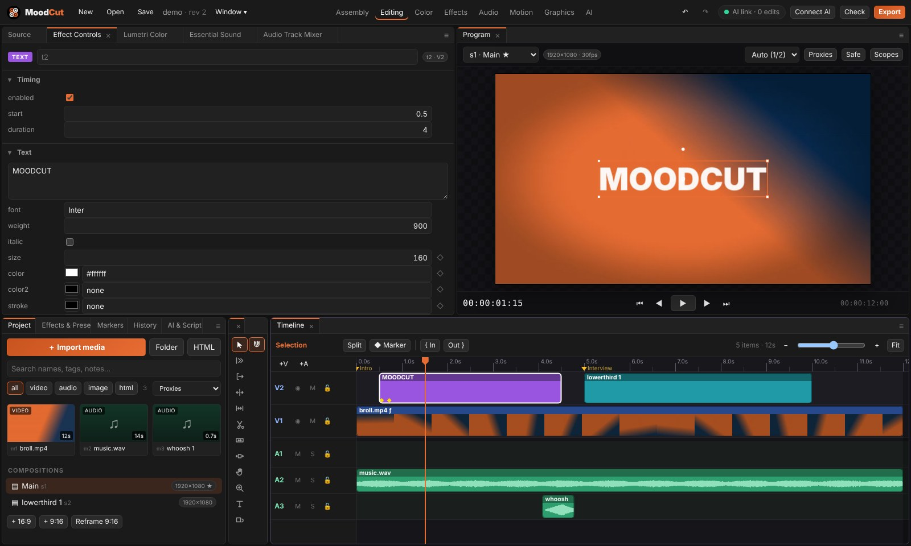

<p align="center">
  <picture>
    <source media="(prefers-color-scheme: dark)" srcset="assets/brand/moodcut-logo-dark.svg">
    
  </picture>
</p>

<p align="center"><b>The AI-native video editor.</b> Premiere-style editing and After Effects-style motion design that<br>
Claude, ChatGPT and other AI apps can drive over MCP, in one small Windows app with FFmpeg doing the heavy lifting.</p>

<p align="center">
  <a href="#install-windows"><b>Install</b></a> ·
  <a href="#connect-your-ai">Connect your AI</a> ·
  <a href="#smooth-on-any-pc">Performance</a> ·
  <a href="docs/REFERENCE.md">Script reference</a> ·
  <a href="docs/ARCHITECTURE.md">Architecture</a>
</p>



Point your assistant at a folder of footage and ask for the finished piece:

> *"Here's D:\Footage\Summer (about 150 clips) and my interview talk.mp4. Make a 30-second 1080p highlight:
> open on the interview, b-roll over it, a beat-cut drone montage to the music, an animated title and a lower
> third with my name, captions and YouTube chapters. Check it and give me the MP4, captions and a Premiere XML."*

The assistant imports and browses the library, reads the transcript, cuts the story, designs the graphics as
HTML, grades and mixes, runs MoodCut's quality check (fixing what it reports), and renders the deliverables,
in about 30 tool calls. You watch the edit build live in the editor window and can take over by hand at any point.
Every click in the GUI goes through the same engine, so the AI always sees what you changed.

## What it can do

**Editing (Premiere-style)**: multi-track timeline with the Premiere tools (selection, track select forward,
ripple and rolling edit, rate stretch, razor, slip, slide), a Source monitor with In/Out and insert/overwrite,
lift/extract over a work area, swap, paste attributes, speed ramps and reverse, freeze frames, time remapping,
frame-blend/optical-flow slow motion, nested sequences, 35 transitions (plus FFmpeg's xfade set), Lumetri color
(basic correction, 15 looks, RGB and hue/saturation curves, color wheels, HSL secondary, `.cube` LUTs) with
waveform, parade, vectorscope and histogram scopes, blur-fill for portrait footage in landscape edits,
Essential Sound (dialogue / music / effects / ambience), an audio track mixer, gain automation, crossfades,
sidechain ducking, measured loudness normalization (hits the LUFS target exactly) and a limiter, 32 audio
effects, and markers with colors, durations and comments.

**Motion design (After Effects-style)**: keyframes on every property with 30+ easing curves and custom béziers,
a keyframe assistant (Easy Ease, reverse, bake, sequence layers), expressions (`wiggle`, `linear`, `ease`,
`random`, `noise`…), parenting and null objects, 3D layers seen through cameras (two-node or one-node, with
push-in, orbit, truck and shake moves) and depth-sorted, the Align panel, a transform gizmo in the monitor,
corner pin, motion blur, masks (feather, expand, modes), track mattes, 32 blend modes, adjustment layers, shape
layers with trim paths and repeaters, per-character text animators, 91 video effects (glow, blurs, chroma key,
wave warp, turbulent displace, linear/radial/venetian-blind wipes, echo and posterize time, lens flare,
glitch, light leaks…), 50+ animation presets and 15 editable motion graphics templates (lower thirds, kinetic
titles, counters, bar charts, callouts, progress bars…).

**Produced, not assembled**: the finishing that separates a professional video from a cut-together one is built
in and named in the AI's guidance. Sound design comes from 13 synthesized effects (whoosh, swish, riser, reverse
swell, downlifter, hit, sub boom, pop, click, ding, glitch, typing, shutter), each a slightly different variation and
placed so its peak lands on the cut, title or beat (`sfx whoosh on=transitions`, `sfx riser at=@drop`). Speed ramps
remap time with eased ramps (`speedramp V1 at=3 to=4x`), punch-ins alternate framing on jump cuts (`punchin V1`),
J and L cuts let sound lead picture, a brand kit gives every title, caption, shape and HTML graphic the same font and
colors (`brand bold` or the client's own), there are 24 looks (Kodak and Fuji film, bleach bypass, commercial,
night, pastel…), punchy creator-style captions, and slam, wipe, whip and glitch entrances. `check target=reels`
(or tiktok, shorts, youtube) knows each platform's UI zones and flags weak hooks, slow pacing, static shots, linear
easing, too many transition types, silent titles, inconsistent type and missing captions.

**HTML motion graphics**: the AI (or you) designs a title, lower third, chart or full-screen animation as
HTML/CSS/JS, the same way Claude builds web artifacts. MoodCut renders it frame by frame in headless Edge/Chrome
on a virtual clock, so CSS animations and transitions, Web Animations, GSAP, anime.js, Lottie, canvas, SVG and
`<video>` all land on exact frames. The result is a transparent video (or a still) added to the media library
and, optionally, placed on the timeline. Templates take `{{name|default}}` variables, so one design makes many
variants. See [examples/graphics](examples/graphics).

**Large libraries**: import whole drives of footage at once (parallel, cached probing; about 150 files in 2–3 s),
skip unreadable files with a report, tag and annotate media, filter by kind, duration, orientation, tags or
words, browse poster-frame sheets of 48 clips per image and per-clip filmstrips, batch-analyze, and search
transcripts across the library.

**AI workflows**: silence removal (jump cuts), scene detection, beat detection with beat-synced montages,
transcription with word-timed animated captions (whisper.cpp, openai-whisper, FFmpeg 8's whisper filter or an
`.srt`), transcript-driven rough cuts, and automatic reframing to 9:16 / 1:1 / 4:5.

**Quality check**: `check` measures the edit instead of trusting it: black gaps and flash frames, clips that
are covered or offline, text outside title-safe or with poor contrast (WCAG ratio measured on the rendered frames),
upscaled or letterboxed footage, frame-rate judder, transitions without source handles, captions that are too fast,
music not ducked under speech, loudness and true peak (measured on the actual mix), and whether the result matches
what was asked (duration, size, captions, music, shot lengths). Each problem comes with a script line that fixes it;
`fix=true` applies them as one undoable edit, and a contact sheet shows the problem frames with safe-area guides.

**Deliverables**: MP4/H.264 (YouTube and social presets), HEVC, AV1, ProRes (incl. 4444 alpha), WebM (incl.
alpha), GIF, PNG sequences and audio formats, with NVENC, QuickSync and AMF encoding. Besides the video:
SRT and WebVTT captions, a YouTube chapter list from markers, an FCP7 XML timeline that Premiere Pro and DaVinci
Resolve open with the original media, and a CMX3600 EDL.

## Install (Windows)

**Installer (recommended).** Download [`MoodCut-Setup-x64.exe`](../../releases/latest/download/MoodCut-Setup-x64.exe)
(also in [`release/windows-x64`](release/windows-x64/)) and run it. It installs for your user with no admin prompt and,
in the same few clicks, can:

- add Start menu and desktop shortcuts, and put `moodcut` on your `PATH` so AI apps and terminals can start it,
- open `.mcut` project files with MoodCut,
- download a portable **FFmpeg** with a progress bar (about 100 MB, kept next to MoodCut),
- **connect the AI apps it finds**: Claude Desktop (including the Microsoft Store build), Claude Code, Cursor, VS Code,
  Windsurf, LM Studio, Gemini CLI and Codex.

Uninstalling (Settings → Apps) reverses all of it, including the AI apps' settings.

**One line in PowerShell** does the same without clicking through:

```powershell
irm https://raw.githubusercontent.com/hamzarasheed309/MoodCut/HEAD/install.ps1 | iex
```

**Portable:** [`moodcut.exe`](release/windows-x64/) alone also works: put it anywhere and double-click it; it offers to
install FFmpeg into `%APPDATA%\MoodCut` on first run. Windows may show *"Windows protected your PC"* because the app
isn't code-signed yet: **More info → Run anyway**.

When MoodCut opens you land on **Home**: start a YouTube, Reel/TikTok, square or 4K project, reopen a recent one, and
finish setup (FFmpeg, AI apps) with one click each. `moodcut doctor` checks everything from a terminal.

Linux and macOS: `curl -fsSL https://raw.githubusercontent.com/hamzarasheed309/MoodCut/HEAD/install.sh | sh`
(a prebuilt binary on Linux x64, otherwise a source build).

Projects are plain JSON (`.mcut`) and autosave. Rendered graphics go next to the project in
`<project> assets/graphics`. Optional: install [whisper.cpp](https://github.com/ggerganov/whisper.cpp)
(`whisper-cli` on `PATH`, model in `%APPDATA%\MoodCut\models` or `MOODCUT_WHISPER_MODEL`) for captions.

## Connect your AI

**AI apps on your computer: one click.** Open **Connect AI** in the editor: every AI app found on the PC is listed with a
**Connect** button (or **Connect all**). From a terminal, `moodcut install-ai` does the same and `moodcut install-ai --list`
shows what is connected. MoodCut merges itself into each app's settings without touching your other tools (comments and
trailing commas in the file are fine), keeps a backup of the original, and leaves a file it can't read alone, printing the
snippet to paste instead. Then restart the app and ask it to "use MoodCut".

| App | Where MoodCut registers |
| --- | --- |
| Claude Desktop | `claude_desktop_config.json` (classic and Microsoft Store builds) |
| Claude Code | `claude mcp add --scope user` |
| Cursor | `~/.cursor/mcp.json` |
| VS Code (Copilot) | user `mcp.json` |
| Windsurf | `~/.codeium/windsurf/mcp_config.json` |
| LM Studio | `~/.lmstudio/mcp.json` |
| Gemini CLI | `~/.gemini/settings.json` |
| Codex CLI | `~/.codex/config.toml` |

The connection is forgiving: `moodcut mcp` attaches to the open editor so edits appear live, finds it on whatever port it
runs, and if the editor is closed mid-conversation it carries on with its own engine and the same project instead of
failing. Starting MoodCut a second time (or double-clicking a `.mcut` file) brings up the editor that's already running.

### Claude on the web (claude.ai) and ChatGPT

Web apps run in the cloud, so they need an HTTPS address that reaches your PC. One command sets it up:

```sh
moodcut connect
```

It opens the editor, starts a free [Cloudflare quick tunnel](https://developers.cloudflare.com/cloudflare-one/connections/connect-networks/do-more-with-tunnels/trycloudflare/)
(it downloads `cloudflared` the first time; no account needed), and prints a connector URL like
`https://quiet-river-1234.trycloudflare.com/mcp/<secret>` (also copied to the clipboard). In the editor,
**Connect AI → Create web link** does the same thing.

- **claude.ai** (Pro, Max, Team, Enterprise): Settings → Connectors → *Add custom connector* → paste the URL → Add.
  Then enable MoodCut in a chat's tools menu.
- **ChatGPT** (plans with developer mode): Settings → Connectors (*Apps* in newer versions) → Advanced → turn on
  *Developer mode* → *Create* → paste the URL, authentication *No authentication*.

Keep the window open while you work. The secret in the URL is the only way in: requests through the tunnel
without it are refused, and it stays the same across restarts (`moodcut connect --new-token` replaces it). The
quick-tunnel hostname changes each time you run `connect`; if you have your own public address (a named Cloudflare
tunnel, Tailscale Funnel or a reverse proxy to port 7878), use `moodcut connect --url https://your.host` to keep
one connector URL for good.

### Desktop and local clients

| Client | How |
| --- | --- |
| **Desktop AI apps** | **Connect AI** in the editor, or `moodcut install-ai` (see above) |
| **Any MCP client over stdio** | command `moodcut`, arguments `mcp` |
| **Any MCP client over HTTP** (Open WebUI, MCP Inspector, your own agent…) | `http://127.0.0.1:7878/mcp` (Streamable HTTP; browser tools on this computer are allowed) |

`moodcut mcp` (stdio) attaches to the editor if it's already open, so AI edits appear live in the window; otherwise
it runs the engine itself and serves the editor at `http://127.0.0.1:7878` (or the next free port).

### Ready-made prompts

MoodCut also offers MCP prompts that clients show as slash commands or prompt pickers: **reel** (Instagram Reels,
TikTok or Shorts), **youtube-video**, **promo** (launch film or ad with kinetic type), **montage** (cut to music),
**edit-folder** (a folder of footage to a finished video), **talking-head**, **social-cutdown** (vertical versions),
**motion-graphic**, **color-grade** and **review** (check an edit and fix it). Each one runs the full workflow below
with your arguments.

## Smooth on any PC

MoodCut previews the way Premiere Pro and After Effects do, so heavy footage plays without a powerful graphics card:

- **Proxies.** Importing 4K, HEVC/AV1/VP9 or high-frame-rate footage makes small H.264 copies in the background (up to
  1280 px, short GOP, `fastdecode`), built one at a time at low priority on two threads. Previews read the proxy, exports
  always read the original. **Proxies** in the Program monitor is Premiere's *Toggle Proxies*; the Project panel's
  **Proxies** menu makes them for every video, deletes them, or changes what new imports get. A "P" marks clips that
  have one. On a 4K HEVC test clip, random-access scrubbing went from 99 to 33 ms a frame and playback rendered twice as fast.
- **Auto playback resolution.** The monitor plays at the smallest of Full, 1/2, 1/4 or 1/8 that still fills its pixels
  (a 4K timeline in a laptop-sized monitor plays at 1/4); paused frames are always rendered sharp at the size shown.
- **Dropped frames instead of stalls.** When a section renders slower than real time, playback repeats frames and keeps
  the sound in sync rather than stopping to buffer.
- **Caches.** Frames you've scrubbed over come back instantly (until something changes); thumbnails are kept on disk
  between sessions; each audio file is decoded once into a peak file, and every waveform (any clip, zoom or size) is
  drawn from it, sharp at any zoom.
- **Gentle on the machine.** Background work (proxies, peaks) runs at below-normal priority, imports probe a bounded
  number of files at once, decoding stays on the CPU (`MOODCUT_HWDEC=1` turns on hardware decoding for previews), and
  HTML graphics render in software (`MOODCUT_BROWSER_GPU=1` to use the GPU) so the graphics card is left to you.

The AI can manage proxies too: `media action=proxy ids=all` (status without ids).

## The editor

The window is built from dockable panels like Premiere Pro and After Effects. Pick a workspace from the top bar
(**Assembly, Editing, Color, Effects, Audio, Motion, Graphics, AI**) or arrange your own: drag a panel's tab onto
another tab bar to group it, onto the edge of a panel to split it, or anywhere else to float it in its own window;
drag the dividers to resize, press <kbd>`</kbd> to maximize the panel you're working in, and reopen anything from
the **Window** menu. Each workspace remembers its arrangement (Window → Reset to saved layout restores it), and on a
narrow window the panels collapse into one column of tabs.

Every control writes a MoodCut Script line through the same engine the AI uses, so each action is undoable, shows
up in History, and is something the AI can do too.

| Panel / tool | What it does | Script it sends |
| --- | --- | --- |
| Tools: Selection (V), Track Select Forward (A), Ripple (B), Rolling (N), Rate Stretch (R), Razor (C), Slip (Y), Slide (U), Hand (H), Zoom (Z) | timeline editing | `move`, `trim … ripple`, `roll`, `fit`, `cut`, `slip`, `slide` |
| Type (T), Shape / Mask (G) | click or drag in the Program monitor | `text … pos=`, `shape rect …`, Alt: `mask <id> rect …` |
| Program monitor | drag a layer to move it, corners to scale, the handle to rotate (keyed when animated); safe guides; scopes | `nudge <id> pos=…`, `preview scope=` |
| Source monitor | preview media, mark In / Out, Insert (`,`) or Overwrite (`.`) into the targeted track | `add m1[2-5] V1 at=… mode=insert` |
| Lumetri Color | basic correction, looks, split toning, curves, hue/sat curves, color wheels, HSL secondary, vignette | `color`, `fx … curves`, `fx … colorwheels` |
| Audio | Essential Sound tags; mixer with pan, faders, mute/solo, track and master effects, loudness target, peak meter | `sound`, `track set`, `master`, `afx` |
| Effect Controls | every property and effect with keyframe navigation, Align & Distribute, Keyframe Assistant | `set`, `kf`, `fx`, `align`, `ease`, `stagger` |
| Markers / History | colored markers with durations and comments; click any step to go back | `marker set`, `undo 3` |
| Effects & Presets | effects, transitions, animations, titles, looks, audio effects and sound FX, applied to the selection or at the playhead | `fx`, `tr`, `anim`, `title`, `sfx whoosh at=…` |
| Brand Kit, Character, Align | the brand's font and colors with presets; type settings of the selected text; After Effects' Align panel | `brand bold`, `set t3 tracking=-2`, `align t3 left to=safe` |
| Audio Track Mixer effect chains | click an effect to bypass it, ⚙ for its settings, ✕ to remove it | `afx A1.a2 off`, `afx A1.a2 ratio=4`, `afx master.a1 del` |

Shortcuts follow Premiere Pro and After Effects: Space, I / O (work area, or In / Out in the Source monitor),
`;` lift, `'` extract, Q / W ripple trim to the playhead, Ctrl+K split, Alt+←/→ nudge clips a frame, Ctrl+arrows
nudge position, Up / Down edit points, Shift+M next marker, J / K keyframes, F9 Easy Ease, Shift+E enable,
`[` `]` and Alt+`[` `]` move or trim layers to the playhead, Ctrl+C / Ctrl+V / Ctrl+Alt+V (paste attributes),
S snapping, X mark clip, Ctrl+Shift+C precompose.

The AI sees the editor too: `sel` and `playhead` in a script mean your selection and playhead, so "grade what I
selected" becomes `color sel cinematic` and "a title here" becomes `text 'Hi' at=playhead`.

## How the AI edits

MoodCut exposes **10 tools** whose definitions total about 11.6 KB (~2,900 tokens), so connecting it costs little context:

| Tool | Purpose |
| --- | --- |
| `project` | new / open / save / undo / redo / history |
| `media` | import files, folders, globs or URLs; list with filters and paging; browse disk folders; preview proxies |
| `edit` | apply a **MoodCut Script**: many edits per call, all-or-nothing |
| `view` | compact text views: timeline, one item, media, markers, transcript, library search |
| `preview` | a frame, a contact sheet of the edit, poster sheets of the library or a clip's filmstrip, as small JPEGs |
| `analyze` | silence, scenes, loudness, beats, transcript, black frames, exposure stats, for one clip or many (cached) |
| `graphic` | design a motion graphic in HTML/CSS/JS; returns the media id, layout checks, JS errors and a frame sheet |
| `check` | measured quality check with expectations and one-step fixes |
| `render` | export a video or a deliverable (captions, chapters, XML, EDL); progress and cancel |
| `help` | the reference, one topic at a time, generated from the engine's schema; `help('workflow')` is the playbook for a complete edit |

Instead of one tool call per operation, the assistant sends a short script and gets back a diff:

```text
text 'SUMMER SALE' at=0.3 dur=3 style=title enter=pop exit=blurOut
title lowerthird text='Jane Doe' sub='Founder' at=4
tr V1 dissolve 0.4
color V1 cinematic
```
```text
ok rev 5 (4 ops)
+t4 text 'SUMMER SALE' V2 0.3-3.3
+n8 lowerthird V2 4-9 (precomp s2: g5,t6,t7)
~V1 2 transition(s) dissolve
~c1..c3.f1 contrast=20 highlights=-15 shadows=8 sat=92 stint=#16707f55 htint=#ff9d5a44
+c1..c3.f2 vignette
s1 dur=12s
```

`view` then returns the whole timeline in a few lines:

```text
s1 'Main' 1920x1080@30 dur=12 [main]
V2: t4 text 'SUMMER SALE' 0.3-3.3 size=120 txanim:in,out | n8 comp s2 4-9
V1: c1 m1 0-4 fx:lumetri,vignette >dissolve:0.4 | c2 m2 4-8 fx:lumetri,vignette >dissolve:0.4 | c3 m3 8-12 fx:lumetri,vignette
A1: -
```

Errors name the line and suggest fixes (`unknown animation 'type'. Did you mean 'typeOut' or 'typewriter'?`),
and a failed script changes nothing. Times can be seconds, timecode, frames, markers (`@drop`) or expressions
like `c3.end+0.5`, and `$` refers to the item just created, so scripts rarely need a round trip to look up ids.

### Editing like a senior editor

Generic output comes from defaults, so the AI is given an editor's and motion designer's judgment as rules it can
act on. `help('style')` covers the hook, pacing per platform, where to cut, motivated transitions, speed, sound
design, color, typography, easing, layout and the tells of generic work, each mapped to the command that does it;
`help('platforms')` has the specs and UI safe zones of Reels, TikTok, Shorts, YouTube, feeds, ads and broadcast;
`help('recipes')` has complete scripts for a creator Reel, a YouTube talking head, a cinematic montage, a product
promo with kinetic type, a podcast clip, a documentary and a tutorial (a test runs every one against the engine).
Then `check` reviews the result the way a finishing editor would. On a Reel built from a talking head:

```text
check s2 'Reel' 1080x1920@30 15.26s: 0 error(s), 2 warning(s), 1 note(s), 1 craft note(s)
4 shots (avg 3.81s, 12 cuts/min) · 1 text · 15 captions · mix -14 LUFS / -3.2 dBTP
N1 c4 (m6 talk.mp4) ends the mix without a fade (abrupt cut-off)
   fix: fade c4 out=1 audio
C1 pacing: average shot 3.81s is slow for Reels (aim 0.8-2 s)
   try: autocut silence V1 ; punchin V1
```

Fixes (`fix:`) can be applied in one undoable step; craft notes (`try:`) are creative calls the AI makes itself and
are never applied automatically.

### Motion graphics as HTML

```json
{"tool": "graphic", "html": "<div class='lt'><b>{{name}}</b><span>{{role|Director}}</span></div><style>…@keyframes…</style>",
 "name": "Lower third", "dur": 4, "vars": {"name": "Jane Doe"}, "place": "V4 at=0.4"}
```
```text
+m158 graphic 'Lower third' 1920x1080 30fps 4s alpha
+c38 clip m158 V4 0.4-4.4
rendered 120 frames in 9.3s -> D:/Edits/promo assets/graphics/lower-third-2a6eaae7.mov
content box 115,830-281,957
```

The reply includes a sheet of frames so the AI sees its design, plus warnings for text outside title-safe,
content clipped by the frame, an empty render, JavaScript errors and unset `{{variables}}`. `id=` re-renders a
graphic in place after a fix (every clip using it updates); `from=` makes a variant with other variables.
Library media can be used inside the page as `src="mc://m3"`. `help('graphics')` has the patterns.

### Checking the work

```text
check s1 'Main' 1920x1080@30 30s: 0 error(s), 1 warning(s), 1 note(s)
27 shots (avg 1.11s, 52 cuts/min) · 6 captions · 2 graphics/overlays · mix -14 LUFS / -3 dBTP
W1 @4.05s c2,c3 from 640x360 sources shown at up to 3x their resolution: soft/pixelated (use higher-res media, smaller scale, or a smaller comp)
N1 @8.62s 26 clips (c5,c6,c7,c8…) are portrait in a landscape comp: black bars on the sides
   fix: set c5..c30 fit=blur
expected: dur 30s ✓ · size 1920x1080 ✓ · captions ✓ · music ✓
1 fix line(s) available: check fix=true applies them in one undoable edit, or edit them yourself
```

See the [MoodCut Script reference](docs/REFERENCE.md) (this is exactly what the AI gets from `help`) and the
[examples](examples/):

- [`motion-graphics.mcs`](examples/motion-graphics.mcs): a 12-second animated explainer with no footage
- [`talking-head.mcs`](examples/talking-head.mcs): jump cuts, grade, captions, lower third, music ducking
- [`beat-montage.mcs`](examples/beat-montage.mcs): beat-synced promo with titles and overlays
- [`vertical-short.mcs`](examples/vertical-short.mcs): turn an edit into a 9:16 Short/Reel
- [`graphics/`](examples/graphics): HTML lower third and kinetic title templates

```sh
moodcut run explainer.mcut @examples/motion-graphics.mcs --create 1920x1080@30
moodcut check explainer.mcut
moodcut render explainer.mcut
```

## Command line

| Command | |
| --- | --- |
| `moodcut` / `moodcut gui [project]` | open the editor (also serves MCP at `/mcp`) |
| `moodcut connect [project] [--url URL] [--new-token]` | editor + HTTPS tunnel + connector URL for claude.ai / ChatGPT |
| `moodcut serve [--port 7878] [--public] [--token T] [--allow DIR]…` | headless editor + MCP server; `--public` listens on all interfaces and requires a token, `--allow` limits file access |
| `moodcut mcp` | MCP over stdio (for Claude Desktop / Claude Code) |
| `moodcut run <project> <script or @file> [--create WxH@fps]` | apply a script and save |
| `moodcut render <project> [-o out] [-p preset] [--range a-b] [--scale 0.5] [--hw auto]` | export (presets include `srt`, `vtt`, `chapters`, `xml`, `edl`) |
| `moodcut frame <project> -t 3.5 -o frame.png` | render one frame |
| `moodcut graphic <file.html> -o out.mov [--dur 5] [--size 1920x1080] [--var k=v]… [--project p --place "V3 at=2"]` | render an HTML motion graphic (`--dur 0 --at 2` for a still) |
| `moodcut check <project> [--fix] [--dur 30] [--size 1080x1920] [--strict]` | quality-check an edit; `--strict` fails on errors (CI) |
| `moodcut doctor` / `moodcut setup [--force]` | check the setup / install (or update) the portable FFmpeg |
| `moodcut setup --from <ffmpeg.zip> [--dest DIR]` | install FFmpeg from an archive you already downloaded (the installer uses this) |
| `moodcut install-ai [apps…] [--list]` | connect MoodCut to the AI apps on this computer (all found when no names are given) |
| `moodcut uninstall-ai [apps…]` | remove MoodCut from the AI apps' settings |
| `moodcut install-claude` | same as `install-ai claude` |

Environment: `MOODCUT_FFMPEG` (folder with ffmpeg/ffprobe, or `none` to run without), `MOODCUT_HOME` (data
folder, default `%APPDATA%\MoodCut`), `MOODCUT_BROWSER` (Edge/Chrome for HTML graphics), `MOODCUT_CLOUDFLARED`,
`MOODCUT_WHISPER_BIN`, `MOODCUT_WHISPER_MODEL`, `MOODCUT_HWDEC=1` (hardware decoding for previews),
`MOODCUT_BROWSER_GPU=1` (GPU for HTML graphics).

Without FFmpeg, MoodCut still opens, edits projects and renders HTML graphics as PNG stills; anything that needs
to decode or encode media explains how to install it, and the editor shows the one-click install.

## Building from source

Requires Rust (stable) and Node.js 20+.

```sh
cd gui && npm ci && npm run build && cd ..   # GUI -> gui/dist (embedded into the exe)
cargo build --release                         # target/release/moodcut(.exe)
cargo test
```

The Windows installer is built with [Inno Setup 6](https://jrsoftware.org/isinfo.php): `iscc /DAppVersion=1.0.0
installer\moodcut.iss` writes `dist\MoodCut-Setup-x64.exe` (CI builds it, installs it silently, checks FFmpeg, PATH and
the file association, and uninstalls it again). `moodcut brand` regenerates the logos, icons and installer artwork from
`crates/moodcut/src/brand.rs`; see [docs/BRAND.md](docs/BRAND.md).

`npm run dev` in `gui/` serves the GUI with hot reload and proxies `/api` (including the WebSocket), `/mcp` and
`/fonts` to a running `moodcut serve`. `moodcut docs > docs/REFERENCE.md` regenerates the reference (CI checks
it is current). The same code builds and runs on Linux (tested in CI) and macOS (untested).

## Architecture

One Rust executable contains the engine, MCP server, HTTP/WebSocket API, CLI and the embedded GUI. FFmpeg (a
separate process) handles decoding, encoding and audio, a multi-threaded compositor does everything visual, and
headless Edge/Chrome rasterizes HTML graphics. See [docs/ARCHITECTURE.md](docs/ARCHITECTURE.md) for the design
and the reasons behind it.

## License

MIT. The bundled Inter font is under the SIL Open Font License (`crates/moodcut/assets/fonts/OFL.txt`).
